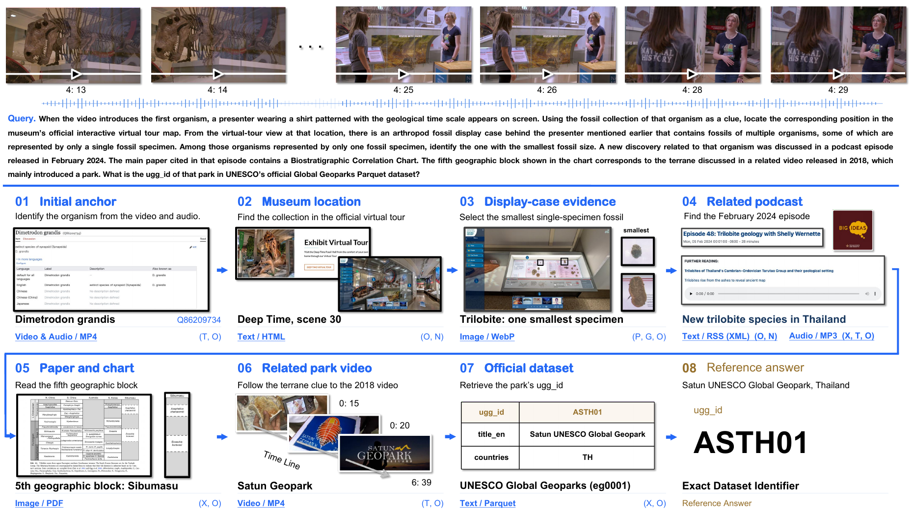

<div align="center">

# OpenDS-World

[English](README.md) · [简体中文](README.zh-CN.md)

### Deep Search in Real-World Web Environments

**From a video clue to a verifiable answer across the open Web.**

<p>
  <a href="https://huggingface.co/datasets/Yu2020/OpenDS-World"></a>
  <a href="LICENSE"></a>
  <a href="https://github.com/Yu-xm/OpenDS"></a>
</p>

<p>
  <a href="#benchmark-results">📊 Benchmark results</a> &nbsp;·&nbsp;
  <a href="https://huggingface.co/datasets/Yu2020/OpenDS-World">🤗 Dataset</a> &nbsp;·&nbsp;
  <a href="docs/evaluation.md">🛠 Evaluation guide</a>
</p>


</div>

**OpenDS-World** studies whether agents can carry out multi-step research in real-world Web environments. Given a question and an initial video, an agent must discover relevant sources, access their content, and connect evidence to determine a unique factual answer. The locations of the evidence and the path to the answer are not supplied in advance.

| **200** challenging tasks | **8** domains | **12** frontier models | **1,000** human attempts |
| :---: | :---: | :---: | :---: |
| Independently verified evidence and answers | From culture and history to science and technology | Evaluated under a shared protocol | Five independent solvers per task |

Open-Web Deep Search (**OpenDS**) brings together three challenges that arise throughout a research task:

| Diverse modalities | Heterogeneous formats | Interactive access |
| --- | --- | --- |
| Connect clues across text, images, audio, and video. | Follow evidence through webpages, documents, media, and structured datasets. | Navigate interfaces, inspect visual scenes, adjust filters, and retrieve resources. |

An example task moves from a museum video to a virtual tour, a fossil display, a podcast, a research paper, and an official dataset. Each source reveals the next clue needed to identify the final answer.

<a href="assets/paper-task-example.png"></a>

<p align="center"><sub>A research trajectory across video, interactive environments, documents, and data.</sub></p>

<a id="benchmark-results"></a>

## 📊 Benchmark Results

> [!NOTE]
> **Even the best-performing model solves fewer than 40% of the tasks.** GPT-6 Astra achieves **39.0%**, followed by Claude Opus 5.5 at **38.0%** and Gemini 3.8 Flash at **36.5%**. All 12 models are evaluated on the same 200 tasks with a shared tool environment and search budget.


<p align="center"><sub>Figure 1 from the paper. Model accuracy is measured over 200 tasks; human accuracy is measured over 1,000 independent attempts.</sub></p>

The human study includes 50 participants, with five independent attempts per task. Participants achieve **21.1% accuracy per attempt**; **42.5% of tasks remain unsolved by all five assigned solvers**. Humans use conventional browsers without LLM assistance and have no fixed per-question time limit. Model search is limited to one hour and 100 tool calls per task.

<details>
<summary><strong>Full model results · Table 1</strong></summary>

| Model | Accuracy | Correct / 200 |
| --- | ---: | ---: |
| **GPT-6 Astra** | **39.0%** | **78** |
| Claude Opus 5.5 | 38.0% | 76 |
| Gemini 3.8 Flash | 36.5% | 73 |
| Claude Fable 5.1 | 33.5% | 67 |
| GPT-5.6 Sol | 28.0% | 56 |
| Qwen3.8-Max | 25.5% | 51 |
| GLM-5.3-Flash | 23.5% | 47 |
| DeepSeek-V4.1-Flash | 20.5% | 41 |
| Kimi K3 | 17.5% | 35 |
| GLM-5.3 (text-only) | 13.5% | 27 |
| DeepSeek-V4-Pro (text-only) | 12.5% | 25 |
| Qwen3.8-Flash | 12.0% | 24 |

Results are transcribed from Table 1 of *Deep Search in Real-World Web Environments* (20 October 2026). Answers are judged for semantic equivalence to the reference using Qwen3.8-27B. The human study is described in Section 2.3.

</details>

The paper also analyzes search cost, tool use, failure recovery, and budget exhaustion. More tool calls and longer runtimes do not consistently yield higher accuracy: coordinating tools and managing long research trajectories remain central challenges.

<a id="dataset"></a>

## 🤗 Dataset

**[🤗 Yu2020/OpenDS-World](https://huggingface.co/datasets/Yu2020/OpenDS-World)** hosts the benchmark release. Download the available files with:

```bash
pip install huggingface_hub
hf download Yu2020/OpenDS-World --repo-type dataset --local-dir data/opends-world
```

Evaluation requires the matching **200-case question/answer CSV and videos**. See [data preparation](docs/evaluation.md#benchmark-data) for the expected format and paths.

<a id="quick-start"></a>

## 🚀 Quick start

### Use your own harness

Download the [dataset](#dataset), run the 200 tasks in your own agent environment, and share your final statistics: evaluated task count, correct answers, accuracy, and judge errors, together with the model, judge, and search budget used. No installation of our tool environment is required. Keep the scoring protocol consistent for comparison; the [scoring guide](docs/evaluation.md#answer-scoring) describes our LLM-as-a-Judge workflow.

### Use the default agent

Install the reference harness (Python 3.10–3.13):

```bash
git clone https://github.com/Yu-xm/OpenDS.git
cd OpenDS
python3 -m venv .venv
source .venv/bin/activate
pip install -e .
```

Follow the [environment and data setup](docs/evaluation.md#run-a-real-case), then **generate answers and score them separately**:

```bash
opends-world --config evaluation.yaml

python ops/judge_predictions.py \
  --predictions /path/to/predictions.csv \
  --output-dir /path/to/judgments \
  --model-id your-judge-model \
  --base-url https://your-endpoint/v1
```

> [!IMPORTANT]
> The judge reads its key from `MODEL_API_KEY` and writes accuracy to `summary.json`. The agent's `success` status indicates execution completion; answer correctness is determined by the separate judge step. See the [scoring guide](docs/evaluation.md#answer-scoring) for output details and error accounting.

## 📖 Citation & License

If you find this work useful, please cite:

```bibtex
@misc{yu2026opendsworld,
  title  = {Deep Search in Real-World Web Environments},
  author = {Xiaomin Yu and Hongliang Chen and Zhe Huang and Shilin Yan and
            Shao-Rong Su and Xuqiao Ma and Feiyang Wang and Jiayu Chen and
            Jiwei Fang and Yu Yan and Yini Huang and Chen Chen and
            Ruoxi Cheng and Yuzhi He and Yuhui Zhang and Xiaoxing Hu and
            Chen Liu and Jianbo Lin and Yijiang Li and Xiaobin Hu and
            Menglong Li and Zhuoran Lu and Weishi Wang and Zhongqi Yue and
            Chengwei Qin},
  year   = {2026}
}
```

Repository-authored code and included examples are released under [Apache-2.0](LICENSE). Videos are distributed separately on Hugging Face; third-party videos are outside this code license grant.

---

<p align="center">
  <a href="LICENSE">Apache-2.0 · code and examples</a> &nbsp;·&nbsp;
  <a href="mailto:yuxm02@gmail.com">Research contact</a>
</p>
