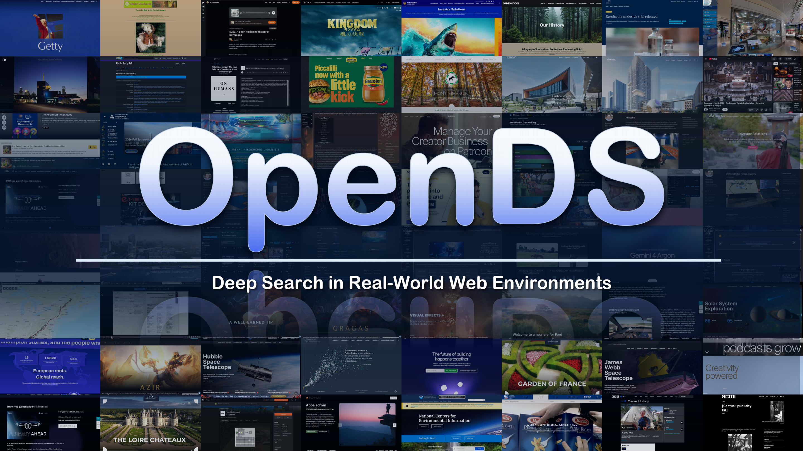
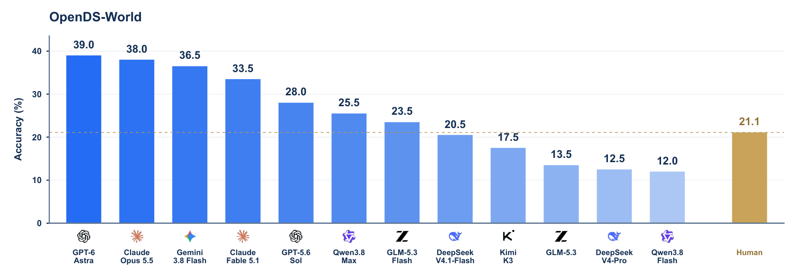

<div align="center">

# OpenDS-World

[English](README.md) · [简体中文](README.zh-CN.md)

### Deep Search in Real-World Web Environments

### 真实 Web 环境中的深度搜索

<p>
  <a href="https://huggingface.co/datasets/Yu2020/OpenDS-World"></a>
  <a href="LICENSE"></a>
  <a href="https://github.com/Yu-xm/OpenDS"></a>
</p>

<p>
  <a href="#基准测试结果">📊 基准测试结果</a> &nbsp;·&nbsp;
  <a href="https://huggingface.co/datasets/Yu2020/OpenDS-World">🤗 数据集</a> &nbsp;·&nbsp;
  <a href="docs/evaluation.md">🛠 评估指南（英文）</a>
</p>



</div>

**OpenDS-World** 是一个开放 Web 深度搜索基准，包含 200 道任务，覆盖 8 个领域。智能体需要在真实 Web 环境中检索、访问并整合多模态证据，回答事实性问题。

| **200** 道任务 | **8** 个领域 | **12** 个模型 | **1,000** 次人工作答 |
| :---: | :---: | :---: | :---: |
| 证据与答案经过独立核验 | 覆盖文化、历史、科学、技术等领域 | 采用统一评估协议 | 每题由五位参与者独立作答 |

| 多模态线索 | 多种内容格式 | 交互式访问 |
| --- | --- | --- |
| 关联文本、图像、音频和视频中的线索。 | 在网页、文档、媒体和结构化数据集中追踪证据。 | 操作界面、观察视觉场景、调整筛选条件并获取资源。 |

<a id="基准测试结果"></a>

## 📊 基准测试结果

> [!NOTE]
> 12 个模型在相同的 200 道任务上，使用统一的工具环境和搜索预算进行评估。最高准确率为 **39.0%**（GPT-6 Astra）。



<p align="center"><sub>结果取自论文图 1。模型准确率按 200 道任务统计，人工准确率按 1,000 次独立作答统计。</sub></p>

人工实验共有 50 位参与者，每道任务由五人独立作答。**单次作答准确率为 21.1%**；**42.5% 的任务在五位参与者的作答中均未被解出**。参与者使用常规浏览器，不使用大语言模型辅助，每题不设固定时间限制。模型每题的搜索预算为一小时、100 次工具调用。

<details>
<summary><strong>完整模型结果 · 论文表 1</strong></summary>

| 模型 | 准确率 | 答对题数 / 200 |
| --- | ---: | ---: |
| **GPT-6 Astra** | **39.0%** | **78** |
| Claude Opus 5.5 | 38.0% | 76 |
| Gemini 3.8 Flash | 36.5% | 73 |
| Claude Fable 5.1 | 33.5% | 67 |
| GPT-5.6 Sol | 28.0% | 56 |
| Qwen3.8-Max | 25.5% | 51 |
| GLM-5.3-Flash | 23.5% | 47 |
| DeepSeek-V4.1-Flash | 20.5% | 41 |
| Kimi K3 | 17.5% | 35 |
| GLM-5.3（纯文本） | 13.5% | 27 |
| DeepSeek-V4-Pro（纯文本） | 12.5% | 25 |
| Qwen3.8-Flash | 12.0% | 24 |

</details>

<a id="数据集"></a>

## 🤗 数据集

从 **[🤗 Yu2020/OpenDS-World](https://huggingface.co/datasets/Yu2020/OpenDS-World)** 下载数据集：

```bash
pip install huggingface_hub
hf download Yu2020/OpenDS-World --repo-type dataset --local-dir data/opends-world
```

评估使用包含 **200 道题目及答案的 CSV 文件与对应视频**。文件格式与路径配置见 [数据准备（英文）](docs/harness.md#benchmark-data)。

<a id="快速开始"></a>

## 🚀 快速开始

### 1. 安装

需要 Python 3.10–3.13。

```bash
git clone https://github.com/Yu-xm/OpenDS.git
cd OpenDS
python3 -m venv .venv
source .venv/bin/activate
python -m pip install -e .
```

### 2. 运行智能体

**使用自己的 Harness**

使用自己的智能体完成[基准任务](#数据集)，将答案导出为 `predictions.csv`：

| 字段 | 内容 |
| --- | --- |
| `id`、`question` | 原始题目 ID 与问题 |
| `gold_answer` | 按 ID 匹配的标准答案 |
| `model_answer` | 智能体最终答案 |
| `status` | 整题执行状态 |

每题导出一行，共 200 行。

**使用默认 Harness**

按照 [Harness 指南（英文）](docs/harness.md)配置模型、工具和数据集，然后运行：

```bash
opends-world --config evaluation.yaml
```

输出位于 `results/<benchmark>/<model>/<run_id>/`，其中 `predictions.csv` 保存答案，`trajectories/` 保存逐题轨迹。

### 3. 评估答案

对任一 Harness 生成的 `predictions.csv` 进行评估。通过环境变量 `MODEL_API_KEY` 设置 Judge API 密钥，然后在仓库根目录运行：

```bash
python ops/judge_predictions.py \
  --predictions /path/to/predictions.csv \
  --output-dir /path/to/judgments \
  --model-id your-judge-model \
  --base-url https://your-endpoint/v1
```

结果文件：`summary.json` 包含准确率、答对题数与 Judge 错误数；`judgments.csv` 和 `judgments.jsonl` 保存逐题判分。

输入格式、判分细节与断点恢复见[评估指南（英文）](docs/evaluation.md)。

## 📖 引用与许可

如果本研究对你的工作有所帮助，欢迎引用：

```bibtex
@misc{yu2026opendsworld,
  title  = {Deep Search in Real-World Web Environments},
  author = {Xiaomin Yu and Hongliang Chen and Zhe Huang and Shilin Yan and
            Shao-Rong Su and Xuqiao Ma and Feiyang Wang and Jiayu Chen and
            Jiwei Fang and Yu Yan and Yini Huang and Chen Chen and
            Ruoxi Cheng and Yuzhi He and Yuhui Zhang and Xiaoxing Hu and
            Chen Liu and Jianbo Lin and Yijiang Li and Xiaobin Hu and
            Menglong Li and Zhuoran Lu and Weishi Wang and Zhongqi Yue and
            Chengwei Qin},
  year   = {2026}
}
```

代码与随附示例采用 Apache-2.0 许可。

## 💬 交流与联系

邮箱：`yuxm02@gmail.com`

<p align="center">
  
</p>
